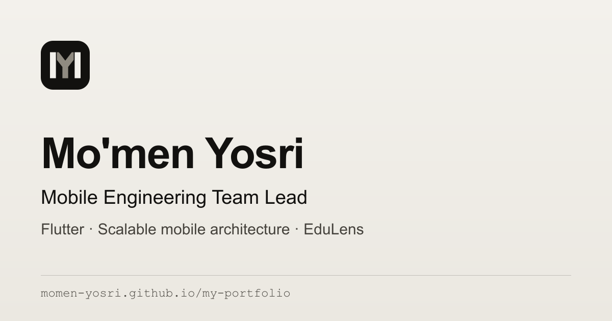
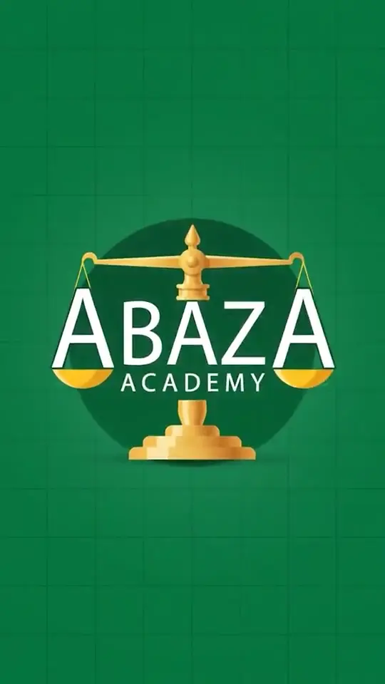
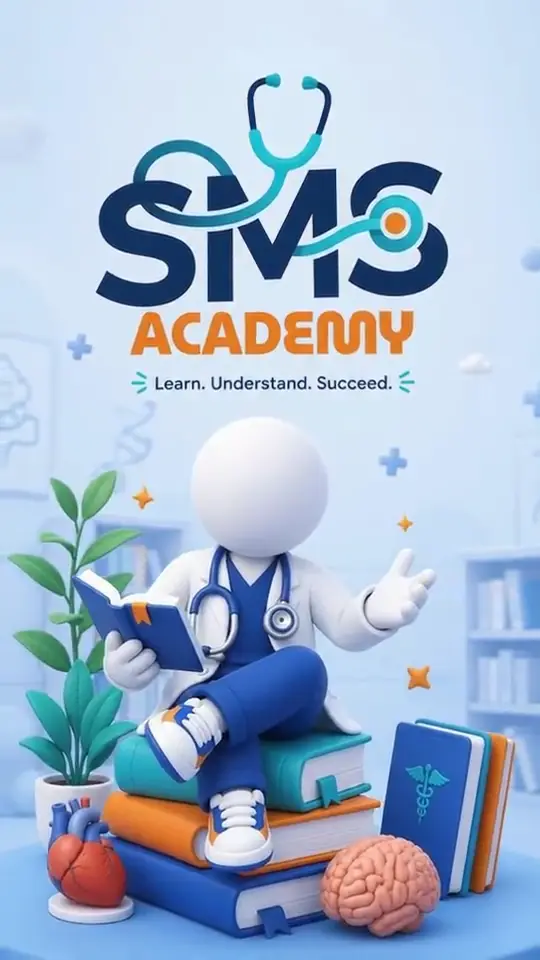
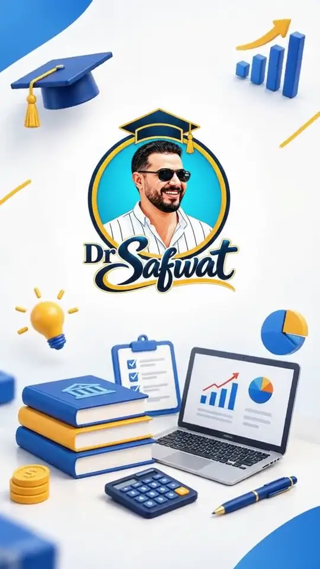
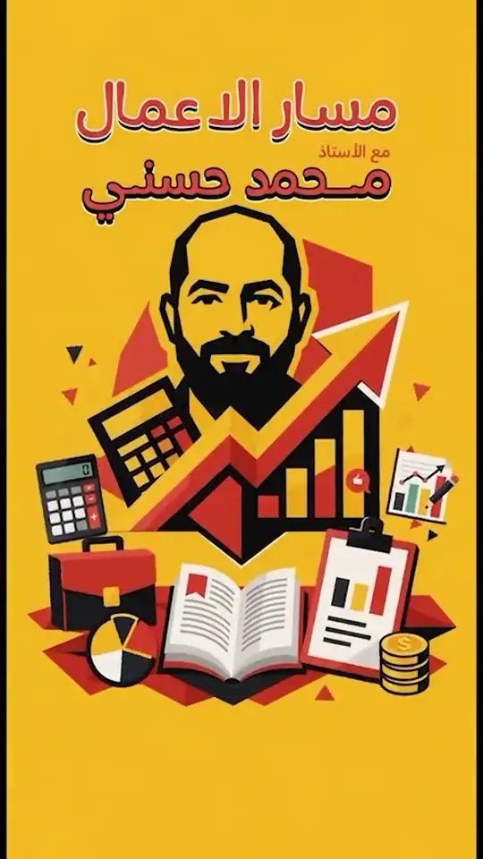

# Mo'men Yosri

**Team Lead, Mobile Engineering at EduLens · Flutter**

Building mobile products that scale.

## One core, many identities

I designed `tech_app_core`, a reusable Flutter foundation that powers nine published, branded academy apps. Each one has its own identity on the same codebase.

  
  
  
  
  
  
  
  
  

## Featured work

| Project | What it is | My role | Links |
| --- | --- | --- | --- |
| [White-label Academy Platform](https://momen-yosri.github.io/my-portfolio/projects/white-label-academy-platform/) | Shared Flutter core for branded academy apps | Designed and built | [Golden on App Store](https://apps.apple.com/us/app/id6789908891) · [Google Play](https://play.google.com/store/apps/details?id=com.edulens.golden) |
| [NASU](https://momen-yosri.github.io/my-portfolio/projects/nasu-university-learning-app/) | University learning management app | Managed the project and led mobile development | [App Store](https://apps.apple.com/us/app/nasu/id6761329211) · [Google Play](https://play.google.com/store/apps/details?id=com.edulens.nasu) |
| [EduLens](https://momen-yosri.github.io/my-portfolio/projects/edulens-student-app/) | Education marketplace | Took over, maintained and extended | [App Store](https://apps.apple.com/us/app/edulens/id1666623278) · [Google Play](https://play.google.com/store/apps/details?id=com.edu.lens.tec) |
| [CARVEN](https://momen-yosri.github.io/my-portfolio/projects/carven/) | Online courses with center attendance | Led alongside another developer | [App Store](https://apps.apple.com/us/app/carven-%D9%83%D8%A7%D8%B1%D9%81%D9%86/id6822079153) · [Google Play](https://play.google.com/store/apps/details?id=com.edulens.carven) |
| [EduLens Scanner](https://momen-yosri.github.io/my-portfolio/projects/edulens-scanner/) | Offline-first QR attendance | Designed and built | [Google Play](https://play.google.com/store/apps/details?id=com.edulens.scanner) |

---

App names, logos and screenshots belong to their respective owners and are shown to illustrate my work. Please don't reuse the personal content, photos or branded assets.
